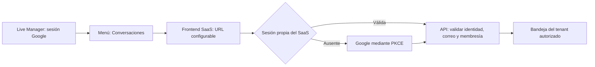

# Acceso desde Live Manager al SaaS

## Estado

- Origen confirmado por el usuario: `https://livemanager.lamadeja.cl`.
- Repositorio de origen inspeccionado: `cesartapian/live-manager-cl`, rama de trabajo local `feature/saas-conversations-entry`.
- Código preparado: entrada **Conversaciones** en el menú autenticado, activada con `VITE_SAAS_APP_URL`.
- Destino SaaS publicado: **pendiente de confirmar**. No se ha creado un dominio ni desplegado una aplicación.
- Revisión/publicación/activación del enlace: pendientes. Ningún cambio en producción se ejecuta al preparar estos archivos.

## Recorrido preparado

El enlace abre una nueva pestaña con `noopener noreferrer` y no incluye tokens, correo ni datos de sesión. Se oculta si no hay destino válido. En producción acepta solo el origen HTTPS del frontend, sin ruta, parámetros, fragmento ni credenciales. En desarrollo también admite HTTP de loopback para pruebas locales.

## Autenticación: navegación no equivale a SSO

Live Manager y el SaaS no comparten automáticamente localStorage o sesión por usar Google. El SaaS restaura su propia sesión o muestra **Entrar con Google**. Google puede reutilizar una sesión existente, pero no se garantiza acceso sin interacción.

El SaaS valida siempre identidad y membresía. Si el entorno usa un proyecto Supabase de desarrollo diferente, el usuario debe existir allí y su membresía debe corresponder a ese usuario. No copiar sesiones de producción ni cambiar la autenticación productiva de Live Manager para simular acceso integrado.

Un puente SSO sin interacción es una decisión posterior y no forma parte de este enlace. No usar tokens en URL ni aceptar parámetros de identidad como autorización.

## Activación pendiente

1. Confirmar/publicar frontend y API del SaaS y su URL HTTPS.
2. Configurar `VITE_SAAS_APP_URL` en el build de Live Manager y revisar/integrar los cambios antes de desplegar.
3. Configurar frontend/API del SaaS con el proyecto Auth seleccionado, origen/API correctos y callback propio `/auth/callback` permitido en Supabase; el callback del proveedor Google es el de Supabase `/auth/v1/callback`.
4. Completar y validar Google, conexión de datos del SaaS y membresía. El usuario ya verificó tabla, restricciones, índices y RLS de la migración 004 en Supabase de desarrollo; falta probar el acceso de API/worker.
5. Probar desde `livemanager.lamadeja.cl` tanto el acceso autorizado como los casos sin sesión y sin membresía. Registrar el resultado en el tablero.

Las pruebas del repositorio Live Manager verifican destinos seguros, visibilidad condicional, accesibilidad con menú colapsado y atributos del enlace. La compilación completa pasó. Esto no prueba navegación productiva ni login real de extremo a extremo.

## Solicitud de paso a producción

El usuario autorizó pasar el enlace a producción. La ejecución está bloqueada, no completada:

- Cloud no tiene acceso autenticado a Vercel: no hay token inyectado, sesión CLI ni conector disponible.
- Se guardó en el borrador del entorno el requisito personal `VERCEL_TOKEN`, limitado al destino HTTPS `api.vercel.com`, sin ningún valor. Debe completarse de forma segura en los ajustes del entorno; guardar el requisito no autentica ni despliega.
- La consulta de despliegues GitHub de Live Manager respondió 403; esto no demuestra que Vercel no tenga despliegues.
- El origen Live Manager está confirmado; el destino publicado del SaaS sigue sin confirmar. No activar el enlace con una dirección inventada.

Al disponer del acceso, inspeccionar los proyectos y despliegues existentes, identificar la URL SaaS y su API y comprobar su configuración, antes de configurar `VITE_SAAS_APP_URL` y desplegar Live Manager. La autorización de producción no elimina la revisión de código ni convierte pruebas sintéticas en una validación real de Google/Supabase. No habilitar envíos WhatsApp reales como parte de publicar este enlace.
