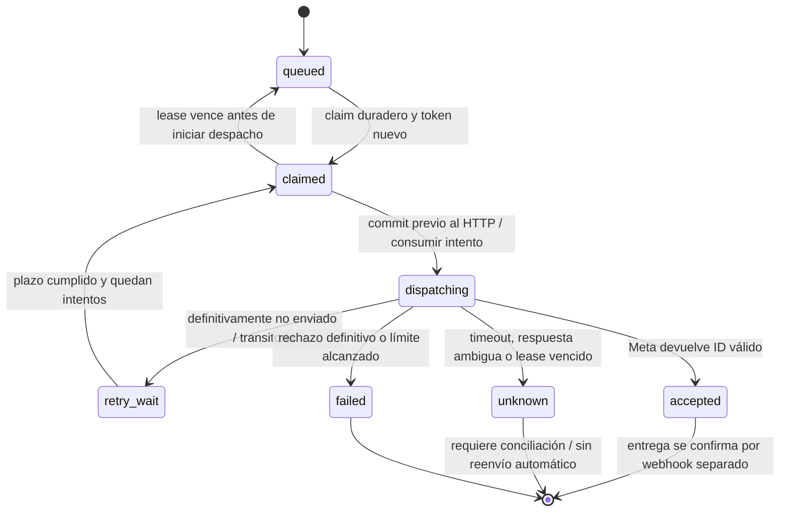

# Envío WhatsApp sandbox: contrato previo al transporte

Estado: diseño, funciones de decisión y repositorio PostgreSQL; **sin conexión al runtime ni envío real**. La migración 005 fue aplicada al proyecto Supabase de desarrollo por autorización del usuario el 26 de octubre de 2026; restricciones, índices y RLS verificados, sin cambios en los conteos de datos existentes. La outbox existente sigue siendo exclusivamente simulada. `OUTBOX_MODE` solo permite `disabled` o `simulated`; no hay una variable nueva que active Meta.

## Por qué la simulación no puede convertirse directamente en transporte

La transacción de simulación se puede revertir, pero una petición aceptada por Meta no se revierte al perder PostgreSQL. Un timeout tampoco demuestra que el proveedor no recibió el mensaje. Reenviar automáticamente un resultado incierto puede duplicar mensajes. No se presume soporte de idempotencia del proveedor ni garantía exactly-once.

El módulo preparatorio `apps/api/src/lib/sandboxDispatch.ts` define decisiones puras. `sandboxRepository.ts` persiste claims/transiciones en transacciones cortas con ámbito explícito, tokens nuevos, versionado y reloj de PostgreSQL. No está montado en rutas ni workers; no autoriza solicitudes por sí mismo ni llama a Meta.

## Contrato de persistencia y límites

1. Crear una cola sandbox separada, con claves compuestas organización/tienda/canal y relación a conversación/destinatario. Mantener la cola simulada y su historial independientes; no reinterpretar registros `simulated` como enviados.
2. Guardar solicitud autenticada e idempotencia local antes de responder. Usar UUID de tarea, versión, token de claim único por adquisición, lease, próximo intento e identificador del proveedor. El token debe ser nuevo e impredecible; el contrato puro no genera tokens ni impide que un llamador reutilice uno.
3. Hacer claim con bloqueo corto y `SKIP LOCKED`; confirmar la transacción. Persistir `dispatching` e incremento de intento mediante comparación de versión/token antes de hacer HTTP. No sostener un bloqueo SQL durante la petición.
4. Al completar, actualizar únicamente si el token/versión aún coincide y el lease está vigente. Un proceso obsoleto no debe sobrescribir un claim posterior ni iniciar otra petición. Si el commit de resultado falla, conservar la clasificación ambigua; no reinvocar el proveedor.
5. Recuperar claims vencidos: `claimed` puede volver a cola porque el contrato prohíbe hacer HTTP antes del commit de `dispatching`; `dispatching` pasa a `unknown`. Incluso un crash anterior al HTTP se trata conservadoramente si ya se confirmó dispatching.
6. Guardar receipts firmados y deduplicados antes de ACK; correlacionar por ID de proveedor y ámbito propio. No aceptar identidad o ámbito enviados por el navegador ni actualizar mensajes de otra tienda. Gestionar callbacks duplicados, desordenados, huérfanos y anteriores al commit de la respuesta del envío. Esta persistencia/conciliación todavía no está implementada.
7. Diferenciar aceptación del proveedor de entrega y lectura. Un ID `wamid` solo permite `accepted`; los estados posteriores dependen de receipts validados. El contrato no incorpora todavía estados delivered/read.

## Clasificación del adaptador pendiente

| Resultado observado | Decisión |
| --- | --- |
| Respuesta válida con ID de mensaje | Guardar accepted y el ID; no reenviar |
| Timeout, desconexión después del posible envío, respuesta inválida o fallo SQL tras HTTP | unknown; sin retry automático |
| Proveedor demuestra que no aceptó la solicitud y el rechazo es transitorio | retry_wait con backoff, Retry-After y límite |
| Proveedor demuestra rechazo permanente | failed |
| HTTP 5xx sin garantía de ausencia de efecto | unknown; no asumir que es reintentable |

Solo el adaptador de confianza podrá producir `definitely_not_sent`; un status HTTP aislado no basta. Una respuesta con ID inválido provoca error de contrato y el integrador debe tratarla como resultado incierto. La reconciliación necesita receipts o verificación autorizada; un operador no debe resolver unknown creando ciegamente una solicitud nueva. El contrato devuelve estados; el guardado atómico y la acción externa no se pueden omitir.

## Admisión sandbox pendiente de integración

La función de política exige habilitación explícita, organización/tienda/canal coincidentes, destinatario E.164 en una lista cerrada, texto no vacío de hasta 4096 caracteres y mensaje entrante real dentro de las últimas 24 horas. Rechaza timestamps futuros y el límite exacto de 24 horas. Las fechas y los IDs deben provenir de registros del servidor; nunca del cuerpo enviado por el cliente.

Esta política es necesaria pero no suficiente: antes de cualquier envío hay que comprobar la política vigente de Meta, número de prueba y destinatarios verificados/consentidos, permisos del operador, credenciales del canal de pruebas, límites globales/por destinatario, tamaño de cola, pausa de emergencia y límites de intentos. Revalidar la política al despachar, no solo al encolar; la ventana puede cerrarse durante la espera. Fuera de esa ventana no habilitar texto libre; plantillas quedan fuera de este incremento.

Las credenciales se guardarán en un gestor seguro, nunca en filas de negocio, logs, argumentos de comandos ni builds del frontend. No se solicitan credenciales de producción. Se requiere autorización explícita y destinatario de prueba confirmado antes de ejecutar una petición real.

## Evidencia y siguiente incremento

Las pruebas unitarias del contrato cubren crash antes/después del inicio duradero, leases vencidos, token obsoleto, timeout ambiguo, aceptación distinta de entrega, retrasos/reintentos y agotamiento, y la política de destinatario/ventana/ámbito. La suite sandboxRepository.test.ts usa PostgreSQL 16 con conexiones independientes para verificar concurrencia, bloqueo saltado, idempotencia, aislamiento, versionado, recuperación y fallo al persistir una confirmación. No prueba transporte Meta.

Implementados en este incremento: migración aditiva 005 y repositorio transaccional con versionado/fencing, recuperación y pruebas de concurrencia en PostgreSQL. Siguiente: persistencia/conciliación de receipts y adaptador Meta de pruebas; después, integración de autorización/política y prueba E2E con número sandbox y autorización. El servidor Oracle y el dominio público siguen pendientes; el desarrollo de estas piezas no depende de que haya capacidad A1 hoy.

## Uso y aplicación de la migración 005

La tabla `sandbox_dispatch` es independiente de `message_outbox`. La clave compuesta impide encolar una conversación bajo otro canal/tienda/organización. RLS queda habilitada sin políticas de navegador. No añade un modo sandbox a OUTBOX_MODE ni instala un worker.

`enqueue` comprueba la membresía del solicitante dentro de la transacción (bloqueo key-share para impedir su borrado concurrente) y devuelve la misma tarea para una solicitud idéntica; rechaza reutilizar la clave para otro cuerpo, destinatario, canal, conversación, solicitante o límite de intentos. `claim` devuelve una tarea con versión/token. `begin` exige esa referencia vigente y devuelve una versión nueva ya confirmada; solo después de recibir ese resultado podría un futuro integrador iniciar HTTP. `complete` debe recibir la referencia actualizada, nunca la de claim. Devuelve null para referencias ajenas, obsoletas o vencidas; los errores de escritura/commit se propagan y no disparan reenvíos. La vigencia también se comprueba en el UPDATE final. `recover` tiene ámbito y límite de lote; debe ejecutarse explícitamente, no hay scheduler conectado.

Las transacciones tienen timeouts; si falla el rollback se descarta la conexión del pool. La comprobación de membresía no sustituye la validación del token ni los permisos/política del futuro endpoint. Si begin/commit arroja un error, el llamador no debe iniciar HTTP; un commit ambiguo queda para recuperación conservadora. Un complete fallido tras el proveedor debe conservarse para conciliación: no llamar nuevamente al proveedor ni encolar otro mensaje. El repositorio no conserva todavía respuestas tardías/receipts, no revalida la ventana de 24 horas al despachar, no impone límites de tasa ni expone una API autenticada. Esas capas son requisitos antes de habilitar el transporte.

La suite usa un esquema UUID temporal en TEST_DATABASE_URL y aplica 001–005 solo allí. CI ya proporciona una base PostgreSQL desechable. No apuntar esa variable a Supabase ni a producción. La migración 005 del PR #18 integrado fue aplicada en desarrollo y verificada mediante metadatos. No volver a ejecutarla ni repetir 001–004. El smoke ampliado ejercita el repositorio compilado con una organización temporal: idempotencia, inicio duradero, rechazo de versión obsoleta y resultados unknown/accepted sintéticos. Elimina sandbox_dispatch antes de la conversación durante la limpieza. No llama a Meta ni demuestra entrega real. No hacer rollback borrando una cola poblada; conservar trabajos accepted/unknown para conciliación.
